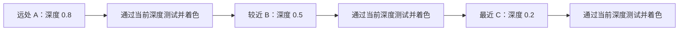
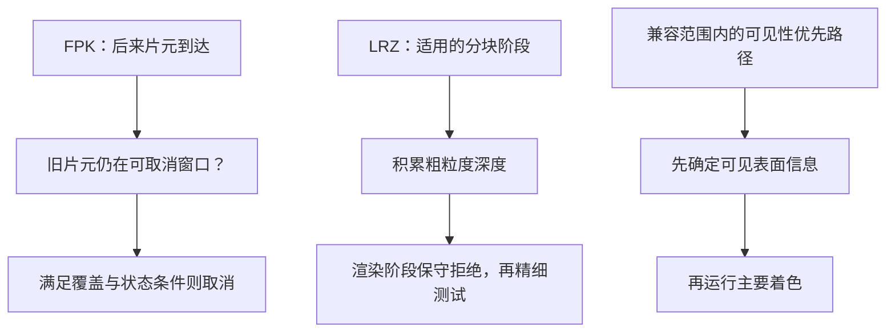
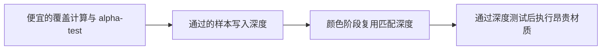

# 各 GPU 架构的 HSR：Early-Z、FPK、LRZ 与可见性预遍历

- 原讨论日期：2026-10-26
- 归档日期：2026-10-28

> 本文整理自历史技术讨论，保留当时的参考资料与适用边界；归档不代表重新验证所有设备、驱动或引擎版本。机制比较不是跨芯片性能实测。

## 原理流程示意

以下三张 Mermaid 图是归档时依据正文新整理的教学示意，不是原对话附件，也不是厂商电路图。省略缓存、调度、兼容性与硬件代际细节；具体限制见正文。

### 示意一：普通 Early-Z 依赖已经建立的深度

此例使用 LESS、背景深度更远、普通不透明表面；更近表面后提交时，早已完成的着色无法由普通 Early-Z 追回。反向提交可先建立遮挡。

### 示意二：提前获取的信息不同

最后一条是 Apple／PowerVR 和新 Arm 预遍历的共同概念抽象，不意味着其内部实现、处理范围或兼容状态相同。

### 示意三：Masked 深度预遍历的作用

这条路径需要引擎保证两遍几何与覆盖一致，并确实移除颜色阶段的 Mask 裁剪；单独改为 EQUAL 不足以保证正确。详见 [Masked Prepass](2026-10-26-masked-prepass.md)。

HSR 要解决的，不只是“最后画面正确”，更是“被遮住的表面，能不能不运行昂贵的片元 Shader”。

这里按 GPU 架构比较，而不是简单按 Android／iOS／Windows：同一系统下可能有不同 GPU，同一家 GPU 也有明显代际差异。以下整理公开资料描述的机制。

## 一、先分清四件事

- 深度测试：判断片元能否通过当前深度条件，保证可见性正确。
- Early-Z：把可提前决定的深度测试放到片元着色前。
- 硬件 HSR：广义包含这些隐藏表面处理；Apple／PowerVR 等文档中也常特指“先确定可见性，再着色”的硬件阶段。
- 引擎遮挡剔除：例如 SDOC、HZB，尽量让整个物体／图元根本不进入后续绘制流程，不是同一层工作。

## 二、为什么有 Early-Z 仍然会 Overdraw？

假设同一像素被 A、B、C 覆盖，深度分别为 0.8、0.5、0.2，小值更近。

如果按远到近提交：
A 比背景近，着色；B 比 A 近，着色；C 比 B 近，再着色。三个都通过了当时的 Early-Z。

反过来先画 C：
C 建立最近深度，后来的 B、A 可以直接被拒绝。

因此，普通 Early-Z 不是预言器：它只知道已经建立的深度，不能自动知道后面会来一堵墙。

更强的延迟可见性方案，会先处理一批图元的覆盖关系，选出最终可见者，再运行主要着色。这里的“只着色一次”是理想不透明例子，不能推广为所有场景保证。[Apple 的官方 HSR 演示](https://developer.apple.com/videos/play/wwdc2020/10602/)

## 三、Hi-Z 为什么比逐像素测深度更省？

可以用一个教学例子理解：某块区域已经全部被深度 0.20～0.35 的表面覆盖，新图元在这块区域最近也只有 0.60。使用 LESS 测试时，这一整块必然失败，可以一起拒绝，不必逐样本处理。

如果无法证明整块都失败，就继续细分或做精细测试。它必须保守：宁可漏剔，不能错剔。

这只是“深度范围摘要”的概念模型，不代表真实硬件元数据就是简单的 max mipmap；逆 Z 时界限方向也要反过来。NVIDIA 官方说明其深度／模板拒绝可从整块光栅区域细到单像素。[NVIDIA Shader 性能指南](https://developer.nvidia.com/blog/advanced-api-performance-shaders/)

下面对比各家的核心实现。重点不是谁“有 HSR”，而是它在什么时候、以什么精度、利用多大范围的信息判断不可见。

## 四、Adreno：LRZ 提前积累粗深度，再精细拒绝

LRZ 是 Low Resolution Z Buffer，低分辨率深度缓冲。

典型分块路径中，Binning 阶段不仅生成 tile 的图元列表，也构建 LRZ；随后 Rendering 阶段先利用 LRZ 拒绝隐藏贡献，再做全分辨率深度测试。

因此，Adreno 不能简单归纳成“只有按提交顺序工作的 Early-Z”。它提前获得了一批几何的粗粒度遮挡信息，有助于消除提交顺序带来的影响。

但 LRZ 不等于逐 sample 的最终可见者表。细小缝隙、复杂覆盖和保守界限无法证明的遮挡，仍须留给精细阶段。

代际与证据边界也很重要：公开细节主要参考 Mesa 驱动开发者的实现／逆向文档，基础研究针对 a6xx，并另列 a650、a7xx 差异，不是高通对所有新芯片的完整规格。例如 a7xx 的双向 LRZ 不能套用早期单向深度规则；discard 资源也可能通过渲染阶段反馈更新 LRZ。[Mesa LRZ 实现文档](https://docs.mesa3d.org/drivers/freedreno/hw/lrz.html)

## 五、传统 Mali：Early-ZS 加 Forward Pixel Kill

Early-ZS 是提前深度／模板测试。FPK 则额外利用有限流水线窗口，取消后来才被挡住的旧工作。

可以这样想：
- 远处片元 A 已通过 Early-Z，正在排队等着色。
- 更近的不透明片元 B 到达，确认覆盖 A。
- 如果 A 仍在可取消窗口内，FPK 可以把它删掉。

它像“在开工前撤销订单”，不是“施工完成后还能退回所有成本”。因此 FPK 能缓解远到近的过绘制，却不保证把完整 tile 的隐藏片元全部消掉。[Arm：FPK 原理](https://developer.arm.com/community/arm-community-blogs/b/mobile-graphics-and-gaming-blog/posts/killing-pixels---a-new-optimization-for-shading-on-arm-mali-gpus)

不同代际流水线细节有差异，不应理解成 GPU 能任意中断所有已运行 Shader。也不要将 Mali 的 TBR 标签直接等价为 Apple 那种可见性优先机制。

## 六、新 Mali／Immortalis：Fragment Prepass 必须单独讲

从 Immortalis-G925、Mali-G725、Mali-G625 引入，不是所有 Immortalis 都有。

它对每个 tile 做两轮：
1. Prepass：遍历兼容图元，求覆盖、深度／模板结果，记录每个 sample 的可见不透明图元。
2. Main pass：没有可见 sample 的图元跳过，其余只让通过可见性检查的片元运行主要着色。

在兼容范围内，这是 sample-perfect 的处理，对前后深度提交顺序不敏感。它不是应用重新提交一遍几何的普通 Z-prepass。

遇到第一个不兼容 draw，该 tile 的预遍历会停止；后续回到常规路径，但 FPK 等机制仍可起作用。[Arm：Fragment Prepass 原理](https://developer.arm.com/community/arm-community-blogs/b/mobile-graphics-and-gaming-blog/posts/immortalis-g925-the-fragment-prepass)

它也不是“discard 一出现就结束”。新机制可以先执行确定覆盖所需的工作，但读改写副作用、部分 coverage 依赖、非不透明绘制同时写深度／模板等状态会影响兼容性。应把兼容绘制尽量放前面，前提是不破坏正确的绘制顺序。[Arm 官方最佳实践，第 48 页](https://vulkan.org/user/pages/09.events/vulkanised-2025/T18-Pete-Harris-Arm-MobileBestPractices.pdf)

## 七、Apple GPU：先保留 Depth＋Primitive ID，再着色

Apple 公开的模型是：先分块，再对 tile 中图元光栅化，暂存最近表面的深度与图元 ID，之后为可见表面执行 Shader。

前述例子中的 A、B、C 可以先后替换同一像素的可见性记录，而不必先后执行三次完整材质。

但是透明混合需要背景颜色，会迫使相应区域把暂存的可见片元先着色。这里的 flush 指执行这些着色工作，不等于必然写回系统内存。[Apple HSR 流程](https://developer.apple.com/videos/play/wwdc2020/10602/)

Apple 推荐先 opaque，再 alpha-test／discard／depth feedback，最后 translucent。不透明组内部通常不必仅为 HSR 做前后排序，但透明组仍要遵守混合所需顺序。[Apple 平台优化建议](https://developer.apple.com/videos/play/wwdc2020/10632/)

## 八、PowerVR：ISP、Tag Buffer、TSP

PowerVR 的公开命名更具体：
- ISP 处理图元位置、隐藏表面以及深度／模板判断。
- Tag Buffer 记录对应像素的前方图元。
- TSP 对保留下来的可见片元做纹理采样与着色。

核心也是先解决可见性，再付出主要材质成本。[PowerVR 逐 tile 光栅化](https://docs.imgtec.com/starter-guides/powervr-architecture/html/topics/per-tile-rasterization.html)

它与 Apple 的公开抽象相近，但不要把 Apple 内部模块直接称为 ISP／TSP，也不能断言二者实现完全相同。

## 九、NVIDIA／AMD 桌面 GPU：重点是分层深度拒绝与 Early-Z

对这两家，实用的概念模型是：粗深度测试、精细 Early-Z、片元 Shader，以及必要时的 Late-Z。

NVIDIA 明确强调保持 Early-Z 有效；AMD 工具则公开 PreZ／PostZ 计数及 HiZ 相关事件。[NVIDIA 指南](https://developer.nvidia.com/blog/advanced-api-performance-shaders/)、[AMD 性能计数器](https://gpuopen.com/manuals/gpu_performance_api_manual/counters/)

不应据此声称桌面 GPU 内部“绝不分块”，现代实现有各种局部性和调度优化。但存在 tile／binning，也不能反推它能像典型不透明 TBDR 那样，默认只着色最终可见层。

桌面上经常采用前到后排序或显式 Depth Prepass，先建立遮挡，再运行昂贵材质。是否划算，要比较省下的片元工作与增加的几何、光栅和深度成本，而不是一律开启。

实践里最容易踩的坑是：不能把“画面看起来不透明”和“硬件可以提前确定遮挡”画等号。

## 十、树叶、玻璃和副作用为什么难处理？

### 1. Alpha Test／discard：要先知道哪里有洞

一张树叶卡片虽然是矩形几何，真正覆盖却由 alpha 纹理决定。GPU 不能先让整个矩形都挡住背景，再发现其中很多像素其实被 discard。

但它仍可能被前面已经确定的不透明墙提前剔除。要区分：
- 它能不能被别人遮住？
- 它能不能提前成为可靠遮挡物？

所以“用了 discard，所有 Early-Z 都失效”是错误总结。PowerVR 官方明确区分提前深度拒绝与需要等 Shader 反馈的深度写入。[PowerVR 的 discard 说明](https://docs.imgtec.com/starter-guides/powervr-architecture/html/topics/rules/do-not-use-discard.html)

### 2. Alpha Blend：后面的颜色本来就需要

玻璃最终颜色包含前层与后层贡献，不能像不透明墙那样只保留最近一层。

所以多层烟雾、粒子、玻璃即使深度处理完全正确，也可能需要很多次着色与混合。但藏在不透明墙后面的透明片元，仍有机会被拒绝。

### 3. Shader 写深度：几何深度未必是最终深度

如果片元 Shader 会改写深度，单凭插值深度可能不足以判断最终结果。具体能否提前拒绝，取决于 API 语义、声明与硬件能力，不能当作普通 opaque。

### 4. Shader 有可见副作用：颜色不可见，不等于这次执行无用

例如向 Buffer 写值、更新计数器。即便后来另一堵墙盖住颜色，这次写操作也可能仍属于程序要求。

Apple 特别指出，显式 early fragment tests 可以根据先前深度拒绝执行，却不能自动恢复普通 opaque 那种“后来被盖住也完全不执行”的能力。[Apple：Shader 优化与副作用](https://developer.apple.com/videos/play/wwdc2016/606/)

新 Arm 预遍历能保留部分副作用语义，所以这里同样不能总结为“所有资源写入都会禁用所有 HSR”。具体看代际和兼容状态。

## 十一、为什么不能直接给所有移动 GPU 加 Depth Prepass？

它可能省掉昂贵材质，也可能只是重复已有工作。

- 依赖 Early-Z、且材质很贵时：显式预遍历可能有收益。
- PowerVR 已经有效消除普通 opaque 过绘制时：单纯为了同一目的再加 Z-prepass，可能增加成本。
- Alpha-test 很贵时：也可能将 alpha 测试集中在深度阶段，再让颜色阶段利用确定深度。
- 后续算法本来就需要完整深度时：还要算这部分复用价值。

[PowerVR 对 Z-prepass 的建议](https://docs.imgtec.com/performance-guides/graphics-recommendations/html/topics/z-pre-pass-and-powervr.html)、[AMD RDNA 优化指南](https://gpuopen.com/learn/rdna-performance-guide/)

## 十二、从 ALU／带宽角度，应该怎样看收益？

HSR 最直接减少的是隐藏片元的材质计算、纹理采样和相关 Shader 工作，不是简单让整张 Render Target 尺寸变小。

因此完全可能出现：
- Shader 调用和 ALU 明显下降。
- 片元纹理访问下降。
- 外部总带宽下降不多。
- 功耗或 GPU 时间仍有改善。

反过来，HSR 仍需要几何处理、分块、光栅化、深度／覆盖判断；它不能代替 CPU／GPU 物体级遮挡剔除。能提前不提交整栋被遮住的楼，通常比提交后再只省掉片元着色更早。

建议用同一个场景做四组控制实验：
- 不透明物体前到后。
- 同样物体远到前。
- 保持几何不变，改为 alpha-test。
- 插入透明绘制或改变颜色写掩码。

保持镜头、分辨率、画质一致，比较 GPU 时间、Fragment Shader 执行量、深度拒绝／FPK／Prepass 计数、外部字节／帧及功率。新 Arm 还可直接查看预遍历覆盖率、剔除率和跳过率。[Arm G925／G725 计数器](https://arm-software.github.io/libGPUCounters/immortalis-g925_and_mali-g725_counter_reference.html)

最后与 Tile Memory Heap 对上关系：

HSR 回答“哪些片元不用算”；Tile Memory Heap 回答“中间结果放哪里、怎样少搬运”。前者主要消除无用工作，后者主要优化数据流。两者可以协同，但开启片上内存功能不等于获得了另一家 GPU 的 HSR 机制。

最值得记住的一句话：
Early-Z 看已经建立的深度；FPK 多利用一个有限的后续窗口；Adreno LRZ 提前建立粗粒度遮挡证据；Apple／PowerVR 和新 Arm 预遍历，则在各自兼容范围内先解决更完整的可见性，再做主要着色。
